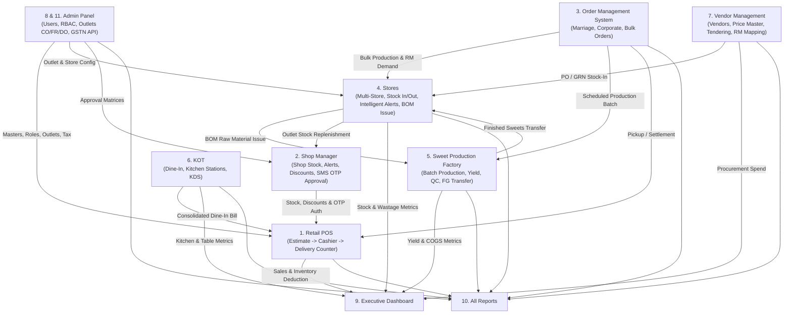
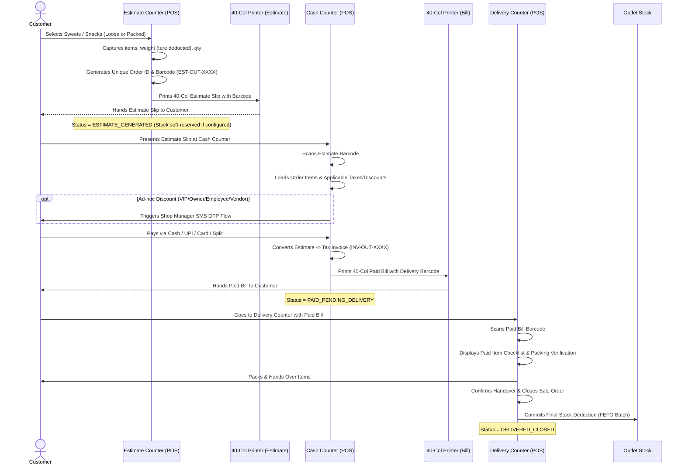
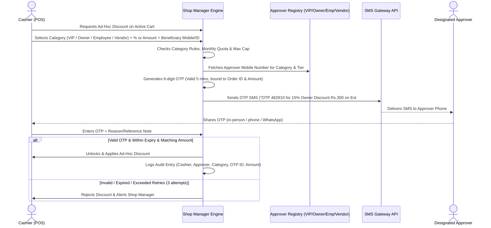
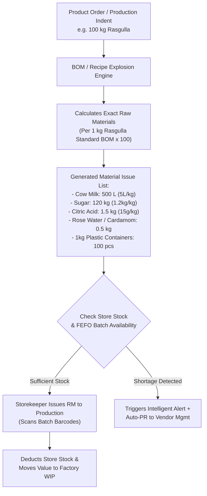
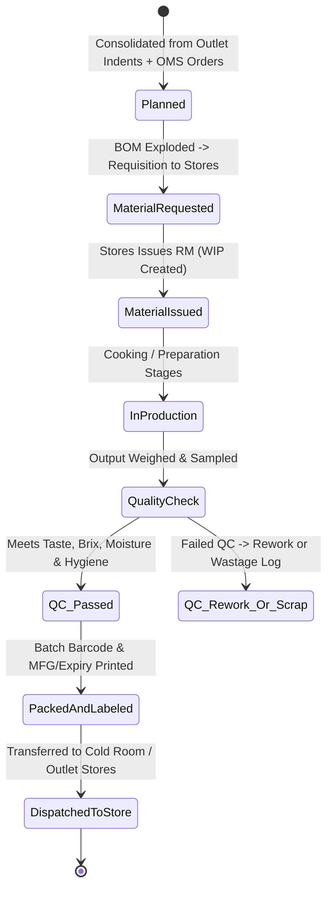
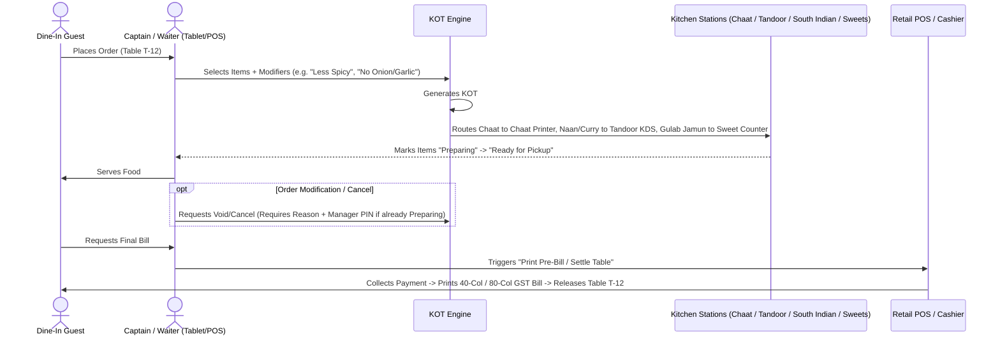
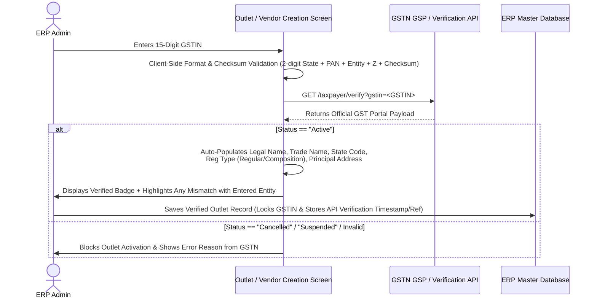

# Food Retail Chain ERP Solution — Full Functional & Modular Workflow Specification
**Domain:** Multi-Outlet Sweet Shop, Restaurant, Hybrid Outlets & Central Sweet Production Factory  
**Document Type:** Functional Architecture & End-to-End Modular Workflow Document  

---

## 1. Executive Summary & Scope

This document defines the complete functional architecture, operational workflows, business rules, data flows, and integration touchpoints for an enterprise **Food Retail Chain ERP** supporting **Sweet Shops**, **Restaurants**, **Hybrid Outlets (Restaurant + Sweet Shop)**, and **Central Sweet Production Factories** across **Company Owned (CO)**, **Franchised**, and **Director Owned (DO)** models.

### Module Map

| # | Module | Core Responsibility |
|---|---|---|
| **1** | **Retail POS** | Counter Estimate generation (40-col barcode slip), Cashier scanning & payment collection (40-col tax invoice), Delivery counter scanning & order closure |
| **2** | **Shop Manager** | Outlet stock visibility, stock alerts, POS oversight, promotional discount creation, SMS OTP validation for ad-hoc VIP/Owner/Employee/Vendor discounts |
| **3** | **Order Management System (OMS)** | Bulk, Marriage, Corporate, and Festival orders; advance payments; production/store reservation; scheduled delivery |
| **4** | **Stores** | Multi-store management, Stock-In/Stock-Out, intelligent stock alerts, BOM-driven raw material issue to Production |
| **5** | **Sweet Production Factory** | Batch production planning, recipe/BOM execution, yield & process loss tracking, QC, batch/expiry labeling |
| **6** | **KOT (Kitchen Order Ticket)** | Dine-in table management, multi-station kitchen routing, KDS/thermal KOT printing, order modification & table settlement |
| **7** | **Vendor Management** | Vendor onboarding, Price Masters, Tendering/RFQ comparison, Vendor-to-Raw-Material mapping, PO & GRN |
| **8 / 11** | **Admin Panel** | User creation, RBAC role assignment, Outlet creation (`CO` / `Franchised` / `DO` & Outlet Types), address/ownership setup, GSTN API validation, system configuration |
| **9** | **Executive Dashboard** | Real-time CXO/Owner/Director KPIs across outlets, ownership types, margins, wastage, discounts, and production variance |
| **10** | **All Reports** | Operational, Inventory, Production, Financial, GST/FSSAI Statutory, and Audit reporting suite |

---

## 2. Enterprise Architecture & Cross-Module Integration

---

## 3. Core Master Data Foundations

Before diving into module workflows, the ERP enforces unified master data across all outlets:

1. **Item / SKU Classification**:
   - **Raw Materials (RM)**: Milk, Sugar, Desi Ghee, Dry Fruits, Flour, Spices, Packaging Boxes.
   - **Semi-Finished / WIP**: Chhena, Khoya/Mawa, Sugar Syrup (Chashni), Base Gravies.
   - **Finished Goods — Sweets & Namkeen (FG-Sweet)**: Sold by weight (kg/g) or box/piece; batch & expiry tracked.
   - **Menu Items — Restaurant (FG-Rest)**: Prepared to order via KOT; mapped to recipe ingredients for theoretical consumption.
   - **Packaging & Consumables**: Sweet boxes (250g, 500g, 1kg), carry bags, disposable containers.
2. **Dual Unit of Measure (UOM) & Weighing Scale Support**:
   - Purchase UOM (e.g., Tin 15 kg, Bag 50 kg) $\rightarrow$ Inventory UOM (kg/litre/pcs) $\rightarrow$ Recipe/POS UOM (grams/ml/pcs).
3. **Outlet Taxonomy**:
   - **Ownership Type**: `CO` (Company Owned), `Franchised`, `DO` (Director Owned).
   - **Outlet Type**: `Restaurant`, `Sweet Shop`, `Restaurant + Sweet Shop`, `Manufacturing`.

---

## 4. Module-by-Module Functional & Workflow Specifications

---

### Module 1: Retail POS (Estimate $\rightarrow$ Cashier $\rightarrow$ Delivery Counter)

#### 4.1.1 Purpose & Scope
Designed for high-footfall sweet shops and quick-service counters where order taking, cash collection, and physical packing/handover are separated across three physical counters to eliminate queues and prevent cash/stock pilferage. Also supports direct single-counter billing when configured.

#### 4.1.2 Hardware & Peripheral Integration
- **40-Column Thermal Printer (Small)** at Estimate Counter (ESC/POS, 58mm roll, 40-char width, Code128/QR barcode).
- **40-Column Thermal Printer (Small)** at Cash Counter (prints Tax Invoice + Delivery Barcode).
- **Barcode Scanner** (1D/2D USB or Wireless) at Cash Counter and Delivery Counter.
- **Electronic Weighing Scale** (RS232/USB) for loose sweets (auto-captures net weight minus box tare weight).
- **Cash Drawer & EDC/UPI Dynamic QR Terminal**.

#### 4.1.3 End-to-End 3-Counter Workflow

#### 4.1.4 Step-by-Step Operational Details

1. **Step 1 — Estimate Generation (Sales Counter)**:
   - Sales staff selects items via touch tiles, SKU search, or barcode scan.
   - For loose sweets, item is placed on integrated weighing scale; system deducts box **Tare Weight** automatically.
   - Staff clicks **Generate Estimate**.
   - System assigns a globally unique Order ID & Barcode (e.g., `EST-DEL01-20261112-0042`) and sets status to `ESTIMATE_GENERATED`.
   - Prints **40-Column Estimate Slip**: Outlet Name, Date/Time, Estimate No., Itemized Qty/Weight, Estimated Total (incl. GST), Validity Note (e.g., "Valid today only"), and scannable Barcode.

2. **Step 2 — Cashier Scanning & Payment Collection (Cash Counter)**:
   - Cashier scans the Estimate barcode; the exact cart loads immediately on the POS screen.
   - Cashier can optionally add/remove impulse items (carry bag, bottled water) or apply promotions/discounts (see Module 2 for SMS-validated ad-hoc discounts).
   - Accepts single or split payment: Cash (with change calculation), UPI/Dynamic QR, Card, Gift Card, Corporate Wallet, or OMS Advance Adjustment.
   - Upon payment confirmation:
     - Estimate transitions to `PAID_PENDING_DELIVERY`.
     - System generates a **GST Tax Invoice** and unique **Delivery Barcode** on a **40-Column Thermal Bill**: Header (Legal Name, Outlet Address, GSTIN, FSSAI), Invoice No., HSN Summary, CGST/SGST breakup, Payment Mode, Delivery Status (`PENDING DELIVERY`), and Barcode.

3. **Step 3 — Delivery Counter Scanning & Order Closure**:
   - Delivery counter screen displays a live queue of `PAID_PENDING_DELIVERY` orders (also serves as verification screen).
   - Customer hands over the printed Paid Bill; delivery staff scans the bill barcode.
   - System verifies:
     - Bill is **Paid** (blocks handover if an Estimate slip is mistakenly presented at the delivery counter!).
     - Bill has **Not already been delivered** (prevents duplicate handover / fraud).
   - Staff verifies item count/weight, packs boxes, and clicks **Confirm Delivery & Close Order** (or auto-closes on scan in Express Mode).
   - Order transitions to `DELIVERED_CLOSED`; outlet inventory is finalized, timestamp and Delivery Staff ID are logged.

#### 4.1.5 40-Column Thermal Slip Layout Specification
- **Character Width**: 40 chars (Font A) / 48 chars (condensed).
- **Estimate Slip**: No GST Invoice claim (`*** ESTIMATE ONLY - NOT A BILL ***`), Item (18 chars) | Qty/Wt (8 chars) | Amt (10 chars), Bottom Barcode (`Code128`).
- **Tax Invoice Slip**: GSTIN, FSSAI, Invoice#, Date/Time, Item | Qty | Rate | Amt, Tax Breakup (CGST/SGST), Payment Ref, Bold `PAID - COLLECT AT DELIVERY`, Delivery Barcode.

#### 4.1.6 POS Controls & Edge Cases
- **Estimate Expiry & Cleanup**: Unpaid estimates auto-expire at End-of-Day (EOD) or after configurable minutes (releasing soft-reserved stock) and appear in the *Unconverted Estimate Audit Report*.
- **Duplicate Scan Protection**: Scanning an already `DELIVERED_CLOSED` bill at the Delivery Counter triggers a red alert (`ALREADY DELIVERED AT <Timestamp> BY <User>`), requiring Manager Override for genuine dispute resolution.
- **Direct Billing Mode**: For low-traffic hours or small outlets, a single terminal can perform Estimate + Payment + Immediate Delivery in one step.
- **Offline Resilience**: Local POS cache queues Estimates/Invoices during internet outage and syncs once online (ad-hoc SMS discounts require connectivity or offline emergency manager token).
- **Shift Open/Close**: Blind cash declaration by cashier at shift end vs. system cash total with variance tracking.

---

### Module 2: Shop Manager

#### 4.2.1 Purpose & Scope
Empowers the Outlet / Shop Manager to control outlet-level inventory health, oversee live POS operations, configure promotional discounts, and enforce strict SMS-authenticated governance on ad-hoc discounts.

#### 4.2.2 Core Capabilities
1. **Shop Stock Levels & Real-Time Visibility**:
   - Live dashboard of counter shelf stock + back-store stock per SKU and Batch (MFG date, Expiry date, Remaining Shelf Life).
   - Quick stock adjustment (spoilage/sampling/breakage) with mandatory reason code.
   - One-click **Outlet Indent** to Central Store / Sweet Production Factory.
2. **Intelligent Shop Stock Alerts**:
   - **Low Stock / Reorder Alert**: Triggered when current stock $\le$ Min Par Level (adjusted by day-of-week/festival multiplier).
   - **Shelf-Life / Near-Expiry Alert**: Color-coded warnings (e.g., Red: expires within 24 hrs for milk sweets; Amber: within 48 hrs) prompting immediate markdown/combo clearance.
   - **Zero-Stock While Active on POS Alert**: Flags items billed into negative stock.
3. **Billing (POS) Oversight**:
   - View active estimates, unpaid carts, pending deliveries, void/refund approvals, and live cashier drawers.
   - Ability to take over any POS session for supervisor overrides.
4. **Structured Discount Creation**:
   - Rule Engine supporting: Percentage (`%`), Flat (`₹`), Buy-X-Get-Y, Combo Bundles (e.g., Festive Sweet + Namkeen Box), Happy Hours (e.g., 20% off fresh snacks after 8 PM), Channel-specific (POS vs OMS), and Outlet-group applicability.
   - Stackability rules (exclusive vs cumulative) and Max Discount Cap.

#### 4.2.3 Ad-Hoc Discount with SMS OTP Validation (VIP / Owner / Employee / Vendor)

#### 4.2.4 Category-Wise Governance Rules
| Beneficiary Type | Verification & Quota Rules | Approver for SMS OTP |
|---|---|---|
| **VIP** | CRM VIP Tag or Reference Name/Phone required | Shop Manager / Area Manager |
| **Owner** | Up to 100% (Complimentary/Owner Treat) allowed with GST compliance tracking | Owner / Director (registered mobile) |
| **Employee** | Employee ID lookup; enforces monthly employee discount wallet/cap (e.g., max ₹2,000/month) | Shop Manager / HR Authorized Number |
| **Vendor** | Linked to active Vendor Code; optionally flags for ledger settlement or goodwill discount | Accounts Head / Shop Manager |

- **Anti-Tampering Rule**: If the cashier edits the cart items or increases quantities *after* the SMS OTP is verified, the discount is automatically invalidated and requires a fresh OTP.

---

### Module 3: Order Management System (OMS)

#### 4.3.1 Purpose & Scope
Manages high-value, scheduled, customized, and bulk orders such as **Marriage/Wedding Orders**, **Corporate Gifting**, **Festival Bulk Orders (Diwali/Holi/Rakhi)**, and **Event Catering**.

#### 4.3.2 Order Lifecycle Workflow

#### 4.3.3 Key Functional Capabilities
1. **Custom Hamper / Assorted Box Builder**:
   - Define custom multi-sweet assortments (e.g., 500 boxes containing 250g Kaju Katli + 250g Besan Laddu + Dry Fruit Pouch + Custom Wedding Ribbon/Card).
   - Dynamic BOM cost calculation to protect minimum target margin before quoting.
2. **Multi-Stage Payment & Advance Tracking**:
   - Booking Advance (e.g., 30%–50%), Interim Milestone Payment, Balance on Delivery/Pickup.
   - Generates Advance Receipt Voucher (GST compliant for advance receipts where applicable).
   - Corporate Credit Orders: Validates against Corporate Customer Credit Limit & PO attachment.
3. **Production & Store Integration**:
   - On order confirmation, OMS checks outlet stock vs. delivery date.
   - Automatically triggers **Production Request** to Sweet Production Factory (Module 5) and **Raw Material / Packaging Reservation** in Stores (Module 4) based on lead time (e.g., T-2 days for fresh sweets, T-7 days for custom printed boxes).
4. **Amendment & Cancellation Lock**:
   - Order edits (qty, assortment, delivery address) allowed freely before `PRODUCTION_LOCKED` cutoff.
   - Post-lock edits require Factory Manager approval and recalculate cancellation/rescheduling charges.
5. **Multi-Drop Delivery & Dispatch Manifest**:
   - Supports single bulk delivery, multiple venue drops (e.g., 3 wedding venues), or distributed voucher/outlet pickup.

---

### Module 4: Stores (Multi-Store Inventory & BOM Issue)

#### 4.4.1 Purpose & Scope
Central nervous system for inventory across **Central Warehouses**, **Factory Raw Material Stores**, **Cold Storage Units**, and **Outlet Back-Stores**, ensuring zero stock-outs, minimal spoilage, and exact recipe-based raw material issuance to production.

#### 4.4.2 Core Capabilities
1. **Multi-Store Creation & Updation**:
   - Create logical & physical stores linked to specific Outlets or Manufacturing units (e.g., `STR-MFG-RM` Factory Raw Material, `STR-MFG-COLD` Cold Room, `STR-OUT01-BACK` Outlet Back-Store).
   - Define store attributes: Temperature Zone (Ambient / Chilled / Frozen), Storage Capacity, Assigned Storekeeper, Active/Inactive status.
2. **Stock-In Workflows**:
   - **Purchase GRN**: Against Vendor PO (captures Batch, MFG Date, Expiry Date, QC Pass Qty, Rejected Qty).
   - **Inter-Store Transfer In (IST-In)**: Receipt against Stock Transfer Dispatch from Central Warehouse / another Outlet (tracks in-transit variance).
   - **Production Finished Goods Inward**: Receiving finished sweets/semi-finished goods from Module 5.
   - **Sales Return / Stock Adjustment In**: With supervisor sign-off.
3. **Stock-Out Workflows**:
   - **BOM-Driven Production Issue**: Issuing raw materials to Production Factory (see 4.4.3).
   - **Inter-Store Transfer Out (IST-Out)**: Dispatch to Outlet stores with E-Way Bill / Delivery Challan generation (mandatory for inter-state or threshold-value transfers between `CO`/`Franchised`/`DO` entities).
   - **Wastage / Spoilage / Expiry Write-Off**: Categorized loss tracking (Transit Damage, Spoilage, Sampling, Expired) for Executive Dashboard visibility.
4. **Intelligent Stock Alerts**:
   - **Dynamic Reorder Point (ROP)**: $(\text{Avg Daily Consumption} \times \text{Vendor Lead Time}) + \text{Safety Stock}$, with **Festival Season Multiplier** (e.g., 3x–5x before Diwali).
   - **FEFO Enforcement (First-Expired, First-Out)**: System blocks issuing newer batches if an earlier-expiring valid batch exists in the store.
   - **Dead-Stock & Slow-Moving Alert**: Highlights ingredients with no movement over $N$ days.
   - **Auto-Purchase Requisition (PR)**: Alerts can auto-draft PRs routed to Module 7 (Vendor Management).

#### 4.4.3 BOM-Driven Raw Material Checkout to Production (Example: 1 kg Rasgulla)

- **BOM Parameterization**: Every finished sweet SKU has a versioned **Bill of Materials (BOM)** defined per standard output unit (e.g., **1 kg Rasgulla**):
  - Standard Ingredients + Packaging + Expected Process Loss % (e.g., whey drainage).
  - Supports **Substitute Ingredients** (approved alternatives when primary RM is scarce) and **Batch Size Rounding** (e.g., round sugar bags to nearest whole packet if needed, tracking unused return to store).
- **Return from Production**: Any unconsumed raw material returned after batch completion is checked back in via **Material Return Note (MRN)** so true batch consumption is accurate.

---

### Module 5: Sweet Production Factory

#### 4.5.1 Purpose & Scope
Manages central and outlet-attached sweet manufacturing—converting raw materials into semi-finished intermediates (Chhena, Khoya, Sugar Syrup) and finished sweets/namkeen with strict **yield variance control**, **food safety/QC**, and **batch traceability**.

#### 4.5.2 Production Workflow

#### 4.5.3 Key Functional Capabilities
1. **Demand Consolidation & Production Scheduling**:
   - Aggregates daily **Outlet Stock Indents** (Make-to-Stock) + **OMS Bulk Orders** (Make-to-Order) into daily **Production Plans** grouped by Sweet Line (Milk Sweets, Ghee Sweets, Dry Fruit Sweets, Namkeen/Savory, Bakery).
   - Allocates production across **Factory Kettles / Karahi Lines / Shift Teams**.
2. **Multi-Stage & Semi-Finished (WIP) Tracking**:
   - Supports 2-level recipes:
     - *Stage 1*: Milk $\rightarrow$ Chhena / Khoya (yield tracked, e.g., 100 L Milk $\rightarrow$ 18–20 kg Khoya).
     - *Stage 2*: Khoya + Sugar + Dry Fruits $\rightarrow$ Burfi / Peda.
3. **Actual vs. Standard Yield & Variance Analysis**:
   - Captures **Actual Output Weight** at completion.
   - Compares against Expected BOM Output; flags variance beyond configurable tolerance (e.g., $\pm 2\%$) to Factory Manager (prevents hidden theft or quality dilution).
4. **Quality Control (QC) & FSSAI Compliance**:
   - Mandatory QC checklist before FG inward: Visual/Aroma, Sugar Syrup Brix %, Moisture %, Temperature check, Allergen tags.
   - Auto-computes **Expiry Date** from MFG Date based on item shelf-life master (e.g., Rasgulla = 3 days chilled; Kaju Katli = 15 days; Namkeen = 60 days).
5. **Batch Labeling & Costing**:
   - Prints Batch/Tray Barcode labels for crates sent to Outlets.
   - Calculates real-time **Batch COGS** = (Actual RM Consumed Cost + Direct Labor/Overhead Allocation) / Actual Good Output kg.

---

### Module 6: KOT (Kitchen Order Ticket) — Restaurant Operations

#### 4.6.1 Purpose & Scope
Handles all dine-in, takeaway, live-counter, and online aggregator orders for `Restaurant` and `Restaurant + Sweet Shop` outlets with multi-station kitchen routing.

#### 4.6.2 KOT Workflow

#### 4.6.3 Key Functional Capabilities
1. **Floor & Table Management**:
   - Visual floor map (AC Hall, Garden, Rooftop, Family Section) with live table states: `Available`, `Occupied`, `KOT Running`, `Bill Printed`, `Cleaning`.
   - Table Merge, Table Split, Table Transfer, and Pax/Cover count tracking.
2. **Multi-Station Routing & KDS / Thermal KOT**:
   - Each menu item maps to a **Preparation Station** (e.g., North Indian, South Indian, Chaat, Chinese, Beverages, Sweet Counter).
   - One Captain order automatically splits into station-specific KOT slips/KDS tiles so chefs only see their relevant items.
3. **Course Management & Modifiers**:
   - Hold & Fire courses (Starters first, Main Course on signal), Cooking instructions (Jain/No Onion-Garlic, Extra Ghee, Spice Level), Combo item selection.
4. **Online Aggregator & QR Ordering Integration**:
   - Direct webhook ingestion from Zomato/Swiggy/Own App + Table QR self-ordering $\rightarrow$ Auto-generates KOT with `AGGREGATOR` / `TAKEAWAY` tag and rider handover verification.
5. **Theoretical Kitchen Stock Deduction**:
   - Every billed/KOT-fired dish deducts underlying kitchen ingredients in Module 4 (Stores) via dish recipes, enabling Food Cost % tracking.

---

### Module 7: Vendor Management & Procurement

#### 4.7.1 Purpose & Scope
Controls supplier onboarding, price governance, competitive tendering, vendor-to-raw-material mapping, and procure-to-pay execution to stabilize food costs across the chain.

#### 4.7.2 Core Capabilities
1. **Vendor Creation & Compliance Onboarding**:
   - Captures Legal Name, Trade Name, Contact Details, Bank Account (IFSC/Cancelled Cheque), PAN, **GSTN (API Validated)**, **FSSAI License No. & Expiry Alert**, MSME Status, Payment Terms (e.g., Net 15/30 days, Advance), and Delivery Regions/Outlets served.
   - Approval workflow before vendor becomes `ACTIVE`.
2. **Vendor-to-Raw-Material Mapping**:
   - Maps each Raw Material SKU to approved Vendors with priority rank: **Primary (Rank 1)**, **Secondary (Rank 2)**, **Backup (Rank 3)**.
   - Stores Vendor SKU Code, Minimum Order Quantity (MOQ), Standard Lead Time (days), and Quality Rating.
3. **Price Master Creation**:
   - Maintains active rate contracts per `(Vendor, Raw Material, Outlet/Region, Effective Date Range)`.
   - Supports tiered/slab pricing (e.g., 1–500 kg vs. 500+ kg), seasonal indexation (milk/ghee/sugar), GST %, and freight inclusion/exclusion.
   - Blocks PO creation above Price Master rate without Procurement Head override.
4. **Tendering / RFQ Workflow**:

5. **PO, Gate Entry, QC & 3-Way Matching**:
   - PO generated from Stores Reorder Alert / OMS Demand $\rightarrow$ Email/WhatsApp PDF to Vendor.
   - On delivery: Gate Entry $\rightarrow$ Quality Check (e.g., Milk fat/SNF test, Dry fruit moisture/infestation check) $\rightarrow$ GRN in Module 4 $\rightarrow$ 3-Way Invoice Match (PO Rate vs GRN Accepted Qty vs Vendor Invoice) $\rightarrow$ Accounts Payable Posting.

---

### Modules 8 & 11: Admin Panel (User/RBAC, Outlet Creation, GSTN API Validation & System Config)

*(Note: Modules 8 and 11 are unified here into two comprehensive administrative pillars covering every specified requirement.)*

#### 4.8.1 Pillar A — User Creation & Role-Based Access Control (RBAC) (Module 8 / 11)
1. **User Management**:
   - Create users with Employee ID, Full Name, Mobile Number (used for OTP & alerts), Email, Assigned Outlet(s)/Factory/Head Office, and Shift/Device binding.
   - Password policy, 2FA/PIN for POS quick switch, User Activation/Suspension (auto-revokes active POS/App tokens).
2. **Granular Role Assignment**:
   - Predefined & custom roles: `Super Admin`, `Director / Owner`, `CXO / Executive`, `Area Manager`, `Shop Manager`, `Estimate Counter Staff`, `Cashier`, `Delivery Counter Staff`, `Kitchen Captain`, `KDS Chef`, `Storekeeper`, `Production Manager`, `QC Inspector`, `Procurement Officer`, `Accounts Manager`, `Franchise Partner`.
   - Permission matrix per module & action: `View`, `Create`, `Edit`, `Delete`, `Approve`, `Void Bill`, `Reprint`, `Max Discount %`, `Cost Visibility` (e.g., hide Factory COGS / Vendor Rates from Store/Cashier staff).
3. **Outlet Scope Control**:
   - `CO` users can be scoped to specific outlets or regions; `Franchised` users are strictly isolated to their own franchised outlet(s); `DO` / `Executive` users get multi-outlet rollups.

#### 4.8.2 Pillar B — Outlet Creation, Ownership & GSTN API Validation (Module 8 / 11)

1. **Outlet Classification Attributes**:
   - **Outlet Ownership Type**:
     - `CO` (**Company Owned**): Full corporate control, centralized accounting & payroll, inter-branch stock transfer pricing.
     - `FR` / `Franchised`: Franchisee legal entity, distinct GSTIN, Royalty % / Fixed Fee rules, Prepaid/Credit Purchase Order billing from Central Factory/Warehouse, restricted visibility to corporate margins.
     - `DO` (**Director Owned**): Owned by specific Director/Partner entity; supports distinct legal entity GSTIN & director-level P&L reporting.
   - **Outlet Type**:
     - `Restaurant` (KOT + Dine-In/Takeaway POS + Kitchen Store)
     - `Sweet Shop` (3-Counter Retail POS + Sweet Store + OMS Pickup)
     - `Restaurant + Sweet Shop` (Unified Hybrid Outlet sharing Cashier/Admin while isolating Kitchen KOT vs Sweet Counter POS)
     - `Manufacturing` (Central Sweet Production Factory + RM/Cold Stores; no retail POS)

2. **Address & Ownership Details**:
   - Legal Entity Name, Trade/Brand Name, Outlet Code, Complete Physical Address, State/PIN Code, Geo-coordinates (for delivery radius & attendance), Lease/Property Ownership details (Owned vs Leased, Landlord info, Agreement Expiry alert), Owner/Director/Franchisee KYC, FSSAI License No. & Expiry, Fire/Trade License details.

3. **GSTN Verification with Live API Validation Workflow**:

4. **System & Peripheral Configuration (Module 11)**:
   - Configure 40-Column Thermal Printer IP/USB profiles per counter, SMS Gateway credentials & DLT templates (for ad-hoc discount OTPs & customer receipts), Payment Gateway/UPI APIs, Tax/HSN Masters (5% Restaurant vs 5% Sweets vs 18% Bakery/Dry Fruits/Catering), and Fiscal Year Document Numbering Series.

---

### Module 9: Executive Dashboard

#### 4.9.1 Purpose & Scope
Real-time command center for **Owners, Directors, and CXOs** providing instant chain-wide visibility with drill-down from Enterprise $\rightarrow$ Ownership Type (`CO` / `Franchised` / `DO`) $\rightarrow$ Outlet Type $\rightarrow$ Individual Outlet $\rightarrow$ Bill/Batch.

#### 4.9.2 Key Dashboard Widgets & KPIs
1. **Live Revenue Ticker**: Today's Net Sales (Sweet Shop POS vs Restaurant KOT vs OMS Bulk vs Aggregators), Comparison vs Yesterday / Same Day Last Year (SDLY), Avg Bill Value (ABV), Footfall/Invoice Count.
2. **Ownership & Outlet Mix Performance**: Revenue, Gross Margin %, and Royalty/Billing split across `CO`, `Franchised`, and `DO` outlets.
3. **Discount & Leakage Monitor**:
   - Total Discounts Given (% of Gross Sales).
   - **Ad-hoc SMS OTP Discount Tracker**: Count & value by category (`VIP`, `Owner`, `Employee`, `Vendor`), flagging outlier outlets or cashiers.
   - Void Bills, Unconverted Estimates, and Cancelled KOT alerts.
4. **Production & Kitchen Efficiency**:
   - Factory Production Output (kg) vs Plan, **BOM Yield Variance %**, Food Cost % (Restaurant), Wastage & Expiry Loss (₹ & % of Sales).
5. **Inventory & Supply Chain Health**:
   - Total Inventory Valuation, Critical Stock-Out Alerts across outlets, Near-Expiry Stock at Risk (₹), Pending OMS Bulk Orders (next 7 days), and Top Vendor Spend / Price Inflation alerts.

---

### Module 10: All Reports

#### 4.10.1 Purpose & Scope
Comprehensive, exportable (PDF, Excel, CSV) and schedulable (Automated EOD Email/WhatsApp) reporting suite across all operational, financial, and compliance functions.

#### 4.10.2 Report Catalog by Category

| Category | Key Reports |
|---|---|
| **1. Retail POS & Sales** | Daily Sales Report (DSR), **Estimate-to-Bill-to-Delivery Funnel Reconciliation** (identifies unpaid estimates & paid-but-undelivered orders), Payment Mode Collection, Cashier Shift Reconciliation, Item-wise & Category-wise Sales, Hourly Peak Load Analysis |
| **2. Shop Manager & Discounts** | Promotional Campaign Performance, **Ad-Hoc Discount SMS OTP Audit Log** (Cashier, Approver, Category, OTP Timestamp, Bill #), Void/Return/Price-Override Audit |
| **3. KOT & Restaurant** | Table Turnaround Time, Kitchen Station Prep-Time SLA, Captain-wise Sales, Void/Cancelled KOT Report, Aggregator Payout & Commission Reconciliation |
| **4. OMS & Bulk Orders** | Bulk/Marriage/Corporate Order Pipeline, Advance & Balance Receivable Aging, Custom Box Production Forecast, On-Time Delivery Performance |
| **5. Stores & Inventory** | Stock Ledger (Opening + In - Out = Closing), Current Stock Valuation (FIFO / Weighted Avg), **Near-Expiry & Ageing Report**, Reorder Alert History, Inter-Store Transfer Register, Wastage/Spoilage/Sampling Report |
| **6. Sweet Production Factory** | Batch Production Register, **Theoretical BOM vs. Actual Raw Material Consumption Variance**, Yield & Process Loss Report, Batch-wise COGS Report, QC Pass/Rejection Log |
| **7. Vendor & Procurement** | Vendor Master & Compliance Expiry (FSSAI/GST), Tender/RFQ Comparative History, Price Master Variance Report, PO vs GRN Pending Register, Vendor On-Time & Quality Scorecard |
| **8. Statutory, GST & FSSAI** | GSTR-1 (B2B/B2C), GSTR-3B Summary, HSN-wise Tax Summary, ITC Register, **FSSAI Forward/Backward Batch Traceability** (Raw Material Batch $\rightarrow$ Production Batch $\rightarrow$ Outlet Delivery) |
| **9. Admin & Franchise** | User Access & Role Change Log, Outlet Master & GSTN Verification Log, **Franchise Royalty & Inter-Company Settlement Statement** (`CO` / `Franchised` / `DO`) |

---

## 5. End-to-End Cross-Module Process Flow (From Raw Material to Customer Handover)

1. **Setup (Admin Panel & Vendor Mgmt)**: Admin creates Outlets (`CO`/`Franchised`/`DO`), validates GSTIN via API, assigns RBAC roles. Procurement onboards Vendors, runs Tenders, sets Price Masters, and maps Vendors to Raw Materials.
2. **Procurement & Inward (Stores)**: Stores raises PR on low-stock alerts $\rightarrow$ PO issued $\rightarrow$ Raw Materials received via QC & GRN into Factory/Central Store (FEFO batch tagged).
3. **Production (Stores + Factory)**: Outlet indents + OMS Marriage/Corporate orders consolidate into Factory Production Orders $\rightarrow$ BOM explodes exact RM requirements (e.g., 1 kg Rasgulla recipe) $\rightarrow$ Stores issues RM to Factory $\rightarrow$ Factory cooks, runs QC, prints Batch/Expiry barcode, and transfers FG to Stores/Outlets.
4. **Outlet Retail Sale (Shop Manager + POS)**: Shop Manager monitors shelf stock & expiry alerts $\rightarrow$ Customer receives **40-col Estimate Barcode** at Sweet Counter $\rightarrow$ Cashier scans Estimate, optionally validates **VIP/Owner/Employee/Vendor discount via SMS OTP**, collects payment, prints **40-col Tax Invoice Barcode** $\rightarrow$ Delivery staff scans Paid Bill barcode, hands over items, and closes the order.
5. **Dine-In Restaurant Sale (KOT + POS)**: Captain fires Table Order $\rightarrow$ KOT splits to Kitchen Stations $\rightarrow$ Food served $\rightarrow$ POS settles consolidated bill.
6. **Oversight (Executive Dashboard & Reports)**: CXOs monitor live sales, `CO`/`Franchised`/`DO` margins, BOM variances, wastage, and GST compliance in real time.

---

## 6. Key Non-Functional & Technical Controls

- **Thermal Printing Speed**: Sub-1.5 second print latency on 40-column ESC/POS printers via local print spooler / WebUSB / network socket so queues never stall.
- **Audit Immutability**: Financial documents (Invoices, GRNs, Stock Issues, SMS OTP Approvals, Void Logs) are append-only with user ID, terminal ID, and timestamp; corrections happen only via Credit Notes / Return Notes / Adjustment Vouchers.
- **Multi-Entity Financial Isolation**: Strict ledger separation across `CO`, `Franchised`, and `DO` legal entities while allowing consolidated management views in the Executive Dashboard.
- **Data Security**: Encrypted PII/mobile numbers, masked API keys for GSTN/SMS/Payment gateways, and automatic POS idle screen lock.
